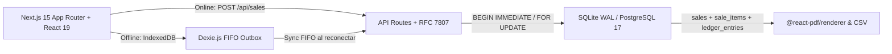

# CajaLedger POS

[](.github/workflows/ci.yml)

**POS transaccional ACID en centavos enteros, control atómico de inventario, libro contable inmutable (append-only con contra-asientos) y cola offline-first con Dexie.js.**

- Demo interactiva: [`/demo`](http://localhost:3009/demo) (15 productos + 14 días de historial contable)
- Documentación OpenAPI 3.1: [`/api/docs`](http://localhost:3009/api/docs)

## Arquitectura



## Decisiones de Arquitectura (ADRs)

1. **ADR-001 — Centavos enteros (`integer-cents`) y tasa en puntos base (`taxBps`)**: Todos los montos monetarios se almacenan y calculan como enteros (`subtotalCents`, `taxCents`, `totalCents`, `profitCents`) para eliminar deriva de punto flotante IEEE-754.
2. **ADR-002 — Transacciones ACID con bloqueo de escritura (`BEGIN IMMEDIATE` / `SELECT ... FOR UPDATE`)**: Las ventas (`createSale`) y anulaciones (`voidSale`) validan stock y mutan inventario dentro de una transacción atómica con `idempotencyKey` único, garantizando cero sobreventa bajo concurrencia.
3. **ADR-003 — Libro contable inmutable (`append-only`) con contra-asientos**: `DELETE /api/sales/{id}` responde `405 Method Not Allowed` (RFC 7807). Las devoluciones usan `POST /api/sales/{id}/void`, que marca la venta `voided`, restaura stock (`reason: "return"`) e inserta un asiento compensatorio (`category: "devolucion"`).

## Setup Rápido (3 pasos)

```bash
pnpm install
pnpm db:migrate && pnpm db:seed
pnpm dev
```

## Trade-offs Honestos (100 → 100k registros)

1. **SQLite WAL local vs. PostgreSQL 17 multi-nodo**: SQLite `node:sqlite` en modo WAL soporta miles de ventas locales con latencia sub-milisegundo y cero infraestructura; al escalar a múltiples cajas concurrentes se activa `schema.pg.ts` con `SELECT ... FOR UPDATE`.
2. **Analítica agregada en memoria vs. vistas materializadas**: `getAnalytics` agrega sobre filas recientes en TypeScript; a partir de ~100k ventas conviene mover las sumas diarias a consultas SQL agregadas o tablas resumen incrementales.
3. **Cola offline en IndexedDB (Dexie.js) vs. CRDTs**: La sincronización FIFO con detección de conflictos `409` es simple y determinista para caja única; múltiples terminales offline editando el mismo SKU requerirían reservas de stock por terminal.
